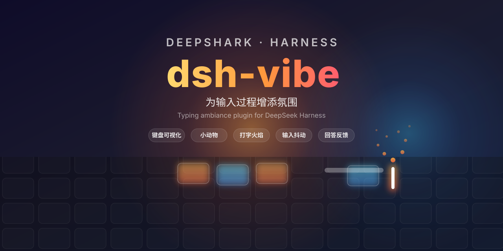

# dsh-thrum

<div align="center">



</div>

DeepSeek Harness (DSH) 输入氛围插件：在输入框上方展示一块 87 键 TKL 键盘 + 鼠标并实时高亮按键与鼠标操作，打字时喷火焰粒子、输入框轻震，AI 回答完成时播放提示音并整页轻震。

<div align="center">


</div>

## ✨ 功能

- **键盘可视化**：87 键 TKL 布局，按键按下时翻面露出随机动物（与小动物共用动物池，池满顶掉最老一只），带平滑翻面动画。
- **小动物**：按频率自动翻出随机动物并驻留，同时最多显示 10 只，池满时新动物顶掉最老的一只；按下按键即刻在按下的键上翻出（加速一次自动翻）。翻出频率可选「关」：空闲不自动翻，按键翻出的动物 1.5 秒后自动翻回。
- **鼠标可视化**：左 / 中 / 右键与滚轮实时高亮，与方向键对齐布局。
- **打字火焰**：在输入框文字光标处按所选样式（关 / 火星 / 蓝焰 / 花火）喷出火焰粒子；选「关」则不显示（新增、删除、粘贴、中文输入都会触发；系统开启「减弱动态效果」时自动关闭）。
- **输入抖动**：每次输入给输入框一个轻微的水平震动，强度分「关 / 轻 / 中 / 强」。
- **回答反馈**：AI 回答完成时按所选样式（关 / 叮 / 风铃 / 泡泡）播放提示音；选「关」则不播放，并按独立的强度档位给整页一个轻微震动。

## 📦 安装

```bash
dsh plugin add github:lhf6623/dsh-thrum
```

> 兼容性：本版本面向 **DSH ≥ 0.2.0**（settings 表单按 profile entry id 投影、`ctx.configForms`、`agent/assistant-stream`）。
> 在 0.1.x 上请使用 0.2.x 版本。

## ⚙️ 配置

### 设置面板（推荐）

在 **设置 → 氛围** 中调整，改动即时生效并保存到本地：

页面是一份扁平列表，没有分组和总开关，每一项独立生效：

| 设置项           | 取值                          |
| ---------------- | ----------------------------- |
| 显示键盘与鼠标   | 开 / 关                       |
| 键盘透明度       | 10% – 100%                    |
| 翻出频率         | 关 / 低 / 中 / 高             |
| 打字火焰         | 关 / 火星 / 蓝焰 / 花火       |
| 输入抖动         | 关 / 轻 / 中 / 强             |
| 整页抖动强度     | 关 / 轻 / 中 / 强             |
| 回答提示音       | 关 / 叮 / 风铃 / 泡泡         |
| AI 陪伴          | 开 / 关                       |

### cordis.yml（部署级默认）

也可在 profile 的 `cordis.patch.yml` 中为插件配置默认值（作为设置面板之下的组装层）：

```yaml
- id: thrum
  name: "dsh-thrum"
  config:
    enabled: true # 显示键盘与鼠标
    opacity: 0.5 # 键盘透明度
    moleFrequency: medium # 翻出频率（off / low / medium / high）；off=空闲不自动翻、按键翻出后自动翻回
    flame: ember # 打字火焰（off / ember / blue / spark）；off=不显示
    shake: off # 输入抖动（off / light / medium / strong）
    pageShakeLevel: off # 整页抖动强度（含 off=关闭，独立于输入抖动）
    sound: ding # 回答提示音（off / ding / chime / pop）；off=不播放
    aiFeedback: true # AI 陪伴（生命感光带）
```

## 📝 版本记录

- 0.3.3 设置面板改为扁平列表：去掉「打字反馈 / 回答反馈」两个分组总开关（各子项已有「关」档位），「键盘外观 / AI 陪伴」降级为普通勾选行；配置契约删除 `feedback`、`response` 两个字段
- 0.3.2 修复回退/删除没有火花 + 空输入框误喷：Lexical 在 keydown 阶段就 `preventDefault` 并自行删除，Backspace/Delete 不会派发 `beforeinput`/`input`，原来的 keydown 兜底又只认可打印字符。现把「真的改文本」的按键补进兜底：Backspace / Delete、Ctrl/Cmd+X/V/Z（剪切/粘贴/撤销重做）；并用 Range 文本投影判断光标方向是否真有可删内容 —— 空输入框、光标已在文本两端都不喷；Shift、方向键、Cmd+A 等非编辑键同样不喷
- 0.3.1 适配 DSH 0.2.0 的 composer：输入宿主已不是 `<textarea>`，而是 Lexical 的 contenteditable `div[data-composer-input]`。打字火焰 / 输入抖动的事件源改为捕获阶段监听 `beforeinput`（主）+ `input` / 可打印键 `keydown`（兜底），并按「一次编辑只广播一次」跨订阅者去重；光标定位对 contenteditable 走 Selection/Range rect、对 textarea 仍用镜像测量；冒烟测试新增假 DOM 真跑「输入 → 光标 → 粒子/抖动」
- 0.3.0 适配 DSH 0.2.0：① 设置面板改用 0.2.0 的 settings 表单（按 profile entry id 投影带 `.volatile()` 的 Config + 浏览器侧 `ctx.configForms.get(id)`），移除已被删除的 `settingsScope` / `settingsNamespace` / `installSettingsSection` / `settings.register` + `scope.watch`；② 逐 token 流动改从实时事件 `agent/assistant-stream` 取文本增量（session 事件 `assistant/chunk` 已不存在），SSE 线协议不变；③ 新增构建期 `assertPatchEntryId()`，防止 patch 的 `id` 与设置 namespace 常量漂移
- 0.2.2 AI 思考过程陪伴：宿主转发会话生命周期事件 + 客户端生命感带 / 逐 token 流动
- 0.2.1 键盘宽度随输入框自适应（足够显示全部 / 只显键盘 / 过窄隐藏）；修复右侧插件占用时键盘定位偏移；抽取共享配置契约、修复输入抖动误依赖 flame、优化 caret 镜像节点、键盘翻面样式 class 化
- 0.2.0 设置面板数据驱动（下拉 / 滑杆 / 勾选）、配置精简（删除 pageShake 与 molePoolSize、动物池固定 10 只）、中英文界面跟随 DSH 系统语言；改用 clsx 拼接 class，样式尽量 class 化
- 0.1.36 新增「翻出频率：关」+ 动物池重做：自动翻动物驻留到池满被顶掉（「同时显示数量」真正生效）；「关」下按键翻出的动物 1.5 秒后自动翻回
- 0.1.35 全部样式改用 UnoCSS 原子类
- 0.1.34 设置迁移到 DSH settings 服务
- 0.1.33 TypeScript 源码拆分重构
- 0.1.28 更名为 dsh-vibe（本插件现名 dsh-thrum）
- 0.1.27 新增回答完成提示音 + 整页抖动
- 0.1.26 新增输入抖动
- 0.1.21 新增打字火焰效果
- 0.1.20 新增设置面板
- 0.1.15 内容区水平居中

## 📄 License

[MIT](./LICENSE)
